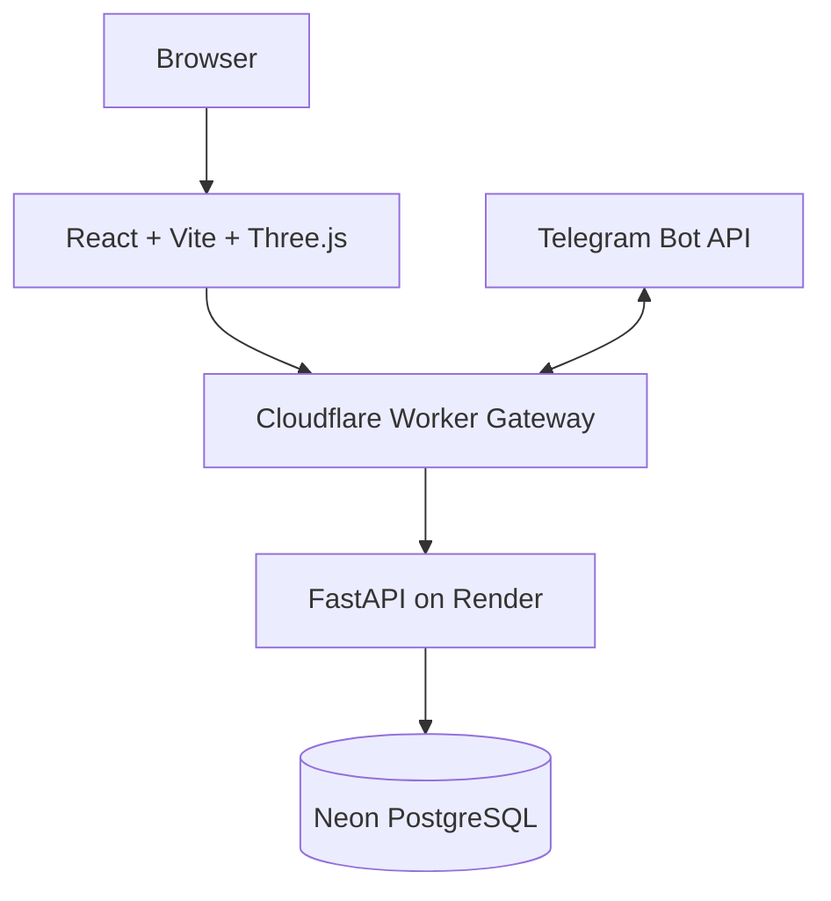

# AuraCraft Studio

<p align="center">
  <strong>CREATE BEYOND THE ORDINARY.</strong><br/>
  A browser-based creative studio for 3D avatars, expressive voice, and video.
</p>

<p align="center">
  <a href="https://auracraft-studio.vercel.app"></a>
  <a href="https://github.com/auracraftstudio/AuraCraft-Studio/issues"></a>
</p>

<p align="center">
  
  
  
  
  
</p>

---

## Overview

**AuraCraft Studio** is a web-based creation environment that brings avatar experiences, voice narration, and video-oriented creator workflows together. The application combines browser-side 3D rendering with a Python API and managed cloud services.

- **Live application:** [auracraft-studio.vercel.app](https://auracraft-studio.vercel.app)
- **Source code:** this repository
- **Default branch:** `main`

## What you can create

| Studio | What it provides |
| --- | --- |
| **3D Avatar Stage** | Browser-based 3D character rendering using Three.js and VRM support |
| **Character Library** | Character records and persona metadata exposed by the backend |
| **Voice & Narration** | Multilingual voice catalog and server-side Edge-TTS synthesis |
| **Video Studio** | Storyboard editing, render-plan manifests, and browser-based narrated capture |
| **OBS Broadcast UI** | Browser-based broadcast and overlay interface |
| **Telegram Integration** | Optional webhook flow through a Cloudflare Worker with request validation and allowlist checks |

> Export formats depend on browser MediaRecorder support. Telegram integration requires the server-side Worker configuration and secrets described in the Worker documentation.

## Technology

| Layer | Stack |
| --- | --- |
| Web client | React, Vite, TypeScript |
| 3D and avatars | Three.js, `@pixiv/three-vrm` |
| API | FastAPI, Uvicorn |
| Speech | Edge-TTS |
| Database | Neon PostgreSQL |
| Gateway / webhook | Cloudflare Workers |
| Hosting | Vercel (frontend), Render (backend), Cloudflare (gateway) |
| Quality checks | GitHub Actions |

## System architecture



The Worker acts as the API gateway: it applies origin checks, injects the server-side API authentication token, and validates Telegram webhook requests before forwarding permitted traffic to the backend.

## Repository layout

```text
apps/
└── web-platform/
    ├── frontend/                 # React + Vite application
    └── backend/
        ├── app/                  # FastAPI application
        └── cloudflare_worker/    # Worker gateway and Telegram webhook
```

## Run locally

### 1. Frontend

```bash
cd apps/web-platform/frontend
npm ci
npm run dev
```

Vite uses port `5180` by default. Set `VITE_API_URL` to a reachable backend or local API gateway when testing API-dependent features.

### 2. Backend

```bash
cd apps/web-platform/backend
python -m venv .venv
# Activate the virtual environment, then:
pip install -r requirements-dev.txt
uvicorn app.main:app --reload --port 8010
```

For persistent local testing, configure `DATABASE_URL` with a PostgreSQL connection string. Without it, the backend uses its local JSON-file adapter.

### 3. Cloudflare Worker

```bash
cd apps/web-platform/backend/cloudflare_worker
npm ci
npm test
npm run lint
npx wrangler deploy --dry-run
```

Do not deploy the Worker until its required secrets and provider settings are configured.

## Configuration and security

Configure secrets in the relevant provider dashboards. Never commit credentials or private identifiers.

Examples of sensitive values include:

- `DATABASE_URL`
- `API_AUTH_TOKEN`
- Telegram bot tokens and webhook secrets
- Private chat IDs and user allowlists

Useful configuration references:

- `render.yaml` — Render backend blueprint
- `apps/web-platform/backend/cloudflare_worker/wrangler.toml` — Worker configuration
- `apps/web-platform/backend/cloudflare_worker/README.md` — Worker secrets and integration setup
- `.env.production.example` — environment variable names and public endpoint references

## CI and quality checks

GitHub Actions is configured for frontend, backend, and Worker checks, including linting, tests, builds, and dependency audits. Review the workflow files under `.github/workflows` for the exact jobs and current status.

## Deployment

| Component | Provider |
| --- | --- |
| Frontend | [Vercel](https://auracraft-studio.vercel.app) |
| Backend API | Render |
| API gateway / Telegram webhook | Cloudflare Workers |
| Persistent database | Neon PostgreSQL |

Provider free-tier quotas, cold starts, usage limits, and policy changes apply. Free-tier use does not guarantee zero cost or uninterrupted availability.

## Contributing

Bug reports and feature requests are welcome through the [GitHub issue tracker](https://github.com/auracraftstudio/AuraCraft-Studio/issues). When reporting a problem, include the affected feature, reproduction steps, expected behavior, and relevant sanitized logs. Do not post secrets or personal data.

## License

MIT
